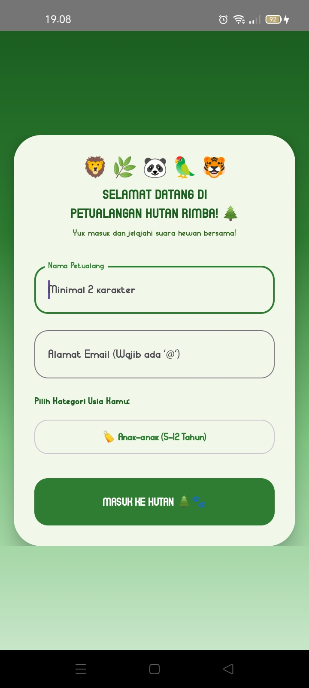
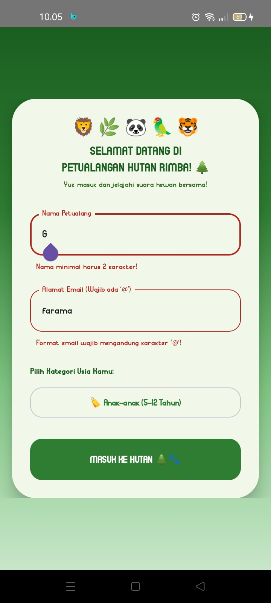
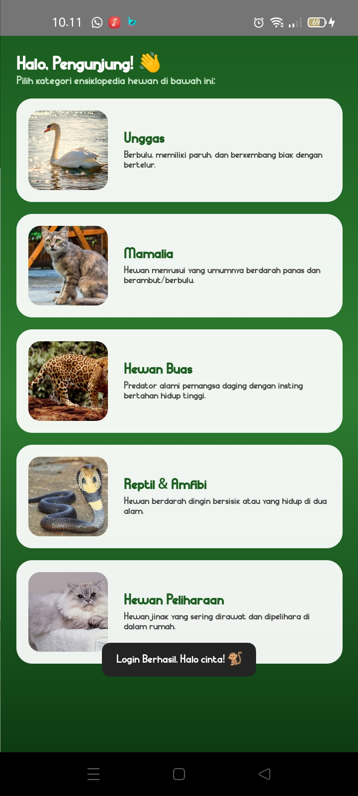
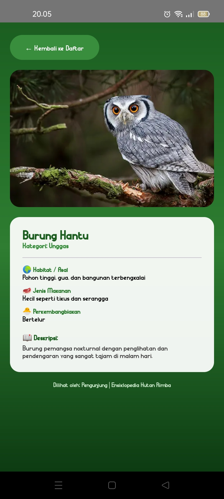

# Ensiklopedia Hewan (Aplikasi Mobile 4-Tier)

Aplikasi **Belajar Mengenal Hewan** berbasis Android yang dikembangkan menggunakan Kotlin dan Jetpack Compose/XML di Android Studio. Aplikasi ini dirancang untuk tugas pemrograman mobile guna mempelajari navigasi multi-layar, *lifecycle*, transfer data antar *Activity*, serta penanganan **validasi input dinamis**.

## 📱 Fitur & Layar Aplikasi (4-Tier Architecture - 5 Layar)

1. **Layar 1 (MainActivity - Beranda)**: Halaman sambutan untuk memasukkan nama, email petualang, dan memilih kategori usia.
2. **Layar 2 (Validasi Input / Error State)**: Tampilan validasi input interaktif. Jika kolom kosong, kurang dari 2 karakter, atau email tidak mengandung `@`, garis kolom berubah menjadi **merah** dan menampilkan pesan error secara langsung.
3. **Layar 3 (SecondActivity - Kategori Umur)**: Halaman yang menampilkan sapaan nama pengguna secara dinamis (*Intent Extra*) serta pilihan kelompok hewan berdasarkan usia.
4. **Layar 4 (ThirdActivity - Daftar Hewan Peliharaan)**: Halaman daftar hewan peliharaan (*Hewan Peliharaan*) yang menampilkan berbagai pilihan seperti Kucing Persia, Kucing Anggora, Kucing Domestik, Kelinci, Ikan Hias, Hamster, dan Marmut.
5. **Layar 5 (FourthActivity - Detail Hewan)**: Halaman detail lengkap mengenai karakteristik, habitat, makanan, dan panduan perawatan hewan.

## 🛠️ Komponen & Teknologi yang Digunakan

- **Bahasa & Framework**: Kotlin, Jetpack Compose / XML Layouts
- **Komponen Utama**: Activity Lifecycle, Intent Data Passing (`EXTRA_USER`, `EXTRA_KATEGORI`, `EXTRA_NAMA`, `EXTRA_EMAIL`), Custom Validation with `isError` State
- **Resource Management**: `strings.xml`, `colors.xml`

## 🚀 Cara Menjalankan Aplikasi (Langsung di HP)

1. **Persiapan HP**:
   - Aktifkan **Developer Options** (Opsi Pengembang) di HP Android kamu.
   - Aktifkan fitur **USB Debugging** di dalam menu Opsi Pengembang.
   - Sambungkan HP ke laptop menggunakan kabel USB.
2. **Clone & Buka Project di Android Studio**:
   - Buka terminal/command prompt, lalu unduh repository dengan perintah:
     ```bash
     git clone [https://github.com/nisaaaaa2130-beep/Latihan-Lifecycle.git](https://github.com/nisaaaaa2130-beep/Latihan-Lifecycle.git)
     ```
   - Buka folder hasil *clone* tersebut melalui Android Studio.
   - Tunggu proses *Gradle Sync* sampai selesai.
3. **Jalankan Aplikasi**:
   - Di bagian atas Android Studio, pastikan perangkat yang dipilih adalah nama HP fisikmu (bukan emulator).
   - Klik tombol **Run (ikon play hijau / Shift + F10)** untuk *build* dan *install* aplikasi secara otomatis langsung ke HP-mu.

## 📸 Tangkapan Layar (Screenshot)

| Layar 1 (Beranda) | Layar 2 (Invalid Input) | Layar 3 (Kategori) | Layar 4 (Hewan Peliharaan) | Layar 5 (Detail Hewan) |
| :---: | :---: | :---: | :---: | :---: |
|  |  |  |  |  |

## 🎥 Demo Aplikasi

Berikut adalah video demonstrasi penggunaan aplikasi:

📹 **Video Demo Aplikasi:** 👉 **[Download & Tonton Video Demo (MP4)](demo_apk.mp4)**  
*(Klik tautan di atas atau pilih file `demo_apk.mp4` di repository GitHub, lalu klik "View raw" untuk mengunduh atau memutar video demonya).*

---
*Dikembangkan untuk pembelajaran Pemrograman Mobile.*
