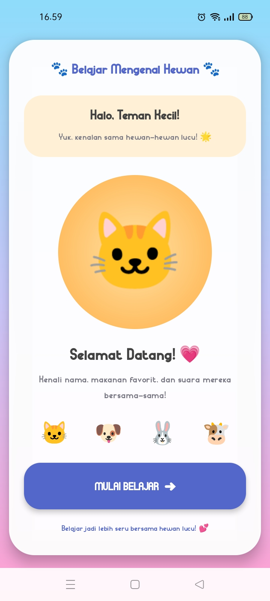
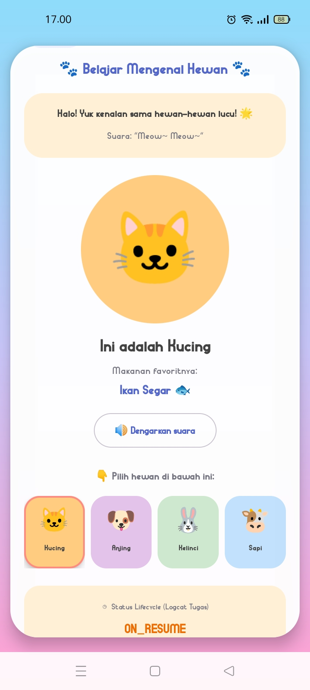

Tugas 1 - Merancang Antarmuka (UI) Dasar Aplikasi Mobile

Aplikasi Belajar Mengenal Hewan berbasis Android yang dikembangkan menggunakan Kotlin dan XML di Android Studio.

📱 Fitur & Layar Aplikasi

1. Layar 1 (MainActivity): Halaman Sambutan / Beranda dengan sapaan ramah dan tombol "Mulai Belajar" ke menu pilihan hewan.
2. Layar 2 (SecondActivity): Halaman Detail Hewan (Kucing) lengkap dengan informasi makanan favorit, suara, dan status lifecycle aplikasi.

🛠️ Komponen UI Dasar yang Digunakan

- View Group: LinearLayout, ConstraintLayout, ScrollView
- View Widgets: TextView, ImageView, Button
- Resource Management: strings.xml, colors.xml

🚀 Cara Menjalankan Aplikasi

1. Build & Install ke HP via Terminal: `./gradlew installDebug`
2. Buka aplikasi di perangkat Android atau Emulator yang terhubung.

📸 Tangkapan Layar (Screenshot)

| Layar 1 (Beranda) | Layar 2 (Detail Hewan) |
| :---: | :---: |
|  |  |
